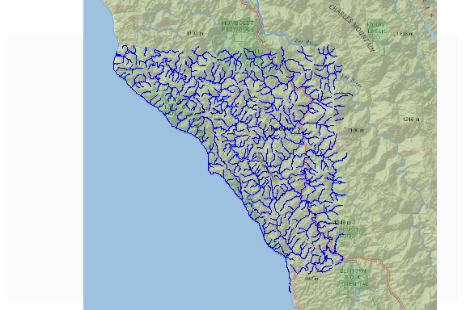
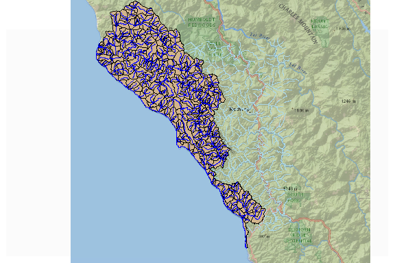
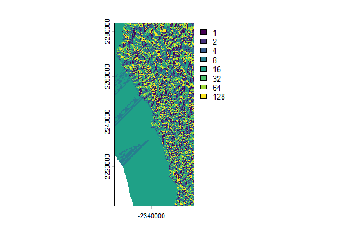
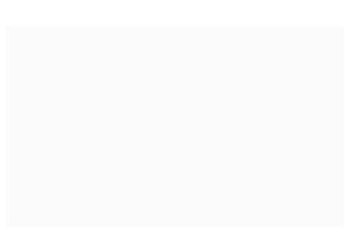

This article demonstrates how to work with coastal catchments and small
coastal basins in an hyRefactor workflow.

First, we use `nhdplusTools` to download and plot some data along the
California coast.

    library(hyRefactor)

    temp_gpkg <- tempfile(fileext = ".gpkg")

    bbox <- sf::st_bbox(c(xmin = -124.4, ymin = 39.8, xmax = -123.7, ymax = 40.3), 
                        crs = sf::st_crs(4326))
    nhd_data <- nhdplusTools::plot_nhdplus(bbox = bbox, gpkg = temp_gpkg, overwrite = TRUE)
    #> although coordinates are longitude/latitude, st_intersects assumes that they are planar
    #> Zoom set to: 10

Now that we have some data to work with, we need to subset it so we have
a few complete basins to work with.

*Note that both basins that terminate at the coast AND the coastal
flowlines are included in out subset below.*

First we use the `nhdplusTools::navigate_nldi` for each terminal
flowline in our subset to find complete basins then we use the
`nhdplusTools::subset_nhdplus` to get the data we need.

    terminals <- dplyr::filter(nhd_data$flowline, TerminalFl == 1)

    coastal <- dplyr::filter(nhd_data$flowline, FTYPE == "Coastline")

    flowline <- dplyr::bind_rows(
      lapply(terminals$COMID, function(x) {
        nhdplusTools::navigate_nldi(list(featureSource = "comid", featureID = x), 
                                    mode = "UT", distance_km = 999)$UT_flowlines
    }))

    sub <- nhdplusTools::subset_nhdplus(c(as.integer(flowline$nhdplus_comid), coastal$COMID), 
                                        nhdplus_data = "download", flowline_only = FALSE)
    #> All intersections performed in latitude/longitude.
    #> Reading NHDFlowline_Network
    #> Writing NHDFlowline_Network
    #> Reading CatchmentSP
    #> Writing CatchmentSP
    #> although coordinates are longitude/latitude, st_intersects assumes that they are planar
    #> although coordinates are longitude/latitude, st_intersects assumes that they are planar
    #> although coordinates are longitude/latitude, st_intersects assumes that they are planar

    sub <- lapply(sub, nhdplusTools::align_nhdplus_names)

    plt <- function(x) sf::st_geometry(sf::st_transform(x, 3857))

    net <- sub$NHDFlowline_Network
    cats <- sub$CatchmentSP

    nhdplusTools::plot_nhdplus(bbox = bbox, nhdplus_data = temp_gpkg, 
                               plot_config = list(
                                 flowline = list(lwd = 0.5, col = "lightblue")), 
                               flowline_only = TRUE)
    #> Zoom set to: 10
    plot(plt(cats), add = TRUE, col = "tan")
    plot(plt(net), add = TRUE, col = "blue")

Now that we have our subset ready to go, we’ll need to get some flow
direction and flow accumulation data to use with hyRefactor later on.

    fdr_dir = file.path(tempdir(check = TRUE), "fdr_fac")
    dir.create(fdr_dir, showWarnings = FALSE)

    if(!dir.exists(file.path(fdr_dir, "NHDPlusCA/"))) {
      hyRefactor::download_fdr_fac(fdr_dir, regions = "18")
    }

    fdr_path <- file.path(fdr_dir, "NHDPlusCA/NHDPlus18/NHDPlusFdrFac18c/fdr/")
    fac_path <- file.path(fdr_dir, "NHDPlusCA/NHDPlus18/NHDPlusFdrFac18c/fac/")

    library(terra)
    #> terra 1.8.93
    #> 
    #> Attaching package: 'terra'
    #> The following objects are masked from 'package:magrittr':
    #> 
    #>     extract, inset
    fdr <- terra::rast(fdr_path)
    fac <- terra::rast(fac_path)
    crs <- terra::crs(fac)
    fdr <- terra::crop(fdr, sf::st_transform(cats, crs))
    fac <- terra::crop(fac, sf::st_transform(cats, crs))
    plot(fdr)

Now that we have all our data ready to go, we can get our networks that
we want to refactor pulled out from our coastal catchments and small
coastal basins.

    coastal <- net[net$FTYPE == "Coastline", ]
    coastal_cats <- cats[cats$FEATUREID %in% coastal$COMID, ]

    net <- dplyr::filter(net, !COMID %in% coastal$COMID)
    cats <- cats[cats$FEATUREID %in% net$COMID, ]
                           
    nhd_outlets <- dplyr::filter(net, TerminalFl == 1)

    sf::st_geometry(nhd_outlets) <- sf::st_geometry(nhdplusTools::get_node(nhd_outlets, "end"))

    nhdplusTools::plot_nhdplus(bbox = bbox, nhdplus_data = temp_gpkg, 
                               plot_config = list(
                                 flowline = list(lwd = 0.5, col = "lightblue")), 
                               flowline_only = TRUE)
    #> Zoom set to: 10
    plot(plt(cats), add = TRUE, col = "tan")
    plot(plt(net), add = TRUE, col = "lightblue")
    plot(plt(coastal_cats), add = TRUE, col = "grey")
    plot(plt(coastal), add = TRUE, col = "blue")
    plot(plt(nhd_outlets), add = TRUE, col = "black")

Now we will identify coastal basins that we want to lump into coastal
catchments as part of the refactor workflow.

    min_da_km <- 10

    little_terminal <- dplyr::filter(net, TerminalPa %in% 
                                       dplyr::filter(nhd_outlets, 
                                                     TotDASqKM <= min_da_km & 
                                                       TerminalFl == 1)$TerminalPa)

    outlets <- dplyr::select(nhd_outlets, COMID) %>%
      dplyr::mutate(type = "terminal") %>%
      dplyr::filter(COMID %in% cats$FEATUREID) %>%
      dplyr::mutate(keep = ifelse(COMID %in% little_terminal$COMID, "temporary", "keep"))

    nhdplusTools::plot_nhdplus(bbox = bbox, nhdplus_data = temp_gpkg, 
                               plot_config = list(
                                 flowline = list(lwd = 0.5, col = "lightblue")), 
                               flowline_only = TRUE)
    #> Zoom set to: 10
    plot(plt(net), add = TRUE, col = "lightblue")
    plot(plt(outlets[outlets$keep == "keep",]), add = TRUE, col = "red")
    plot(plt(outlets[outlets$keep == "temporary",]), add = TRUE, col = "black")

We can now run `refactor_nhdplus` and `reconcile_catchment_divides`.

*Note that the `exclude_cats` parameter is set to all outlet flowlines
in small basins that were identified above.*

*Also note that the `net` variable no longer contains coastal
flowlines.*

    tf <- file.path(tempfile(fileext = "tf.gpkg"))
    tr <- file.path(tempfile(fileext = "tr.gpkg"))

    refactor_nhdplus(nhdplus_flines = net, 
                     split_flines_meters = 100000, 
                     split_flines_cores = 1, 
                     collapse_flines_meters = 2000,
                     collapse_flines_main_meters = 2000,
                     out_refactored = tf, 
                     out_reconciled = tr, 
                     three_pass = TRUE, 
                     purge_non_dendritic = FALSE, 
                     exclude_cats = unique(c(outlets$COMID, little_terminal$COMID)),
                     warn = FALSE)

    refactored <- sf::st_transform(sf::read_sf(tf), crs)
    reconciled <- sf::st_transform(sf::read_sf(tr), crs)
    cats <- sf::st_transform(cats, crs)
    sf::st_precision(cats) <- 10

    divides <- reconcile_catchment_divides(catchment = cats,
                                           fline_ref = refactored,
                                           fline_rec = reconciled,
                                           fdr = fdr_path,
                                           fac = fac_path,
                                           para = 1) 
    #> Linking to GEOS 3.13.1, GDAL 3.11.4, PROJ 9.7.0; sf_use_s2() is FALSE

    nhdplusTools::plot_nhdplus(bbox = bbox, nhdplus_data = temp_gpkg, 
                               plot_config = list(
                                 flowline = list(lwd = 0.5, col = "lightblue")), 
                               flowline_only = TRUE)
    #> Zoom set to: 10
    plot(plt(divides), add = TRUE, col = "tan")
    plot(plt(reconciled), add = TRUE, col = "blue")

Finally, we can identify the outlets

    keep_outlets <- dplyr::filter(outlets, keep == "keep") %>%
      dplyr::select(COMID, type)

    mapped_outlets <- map_outlet_ids(keep_outlets, reconciled) %>%
      dplyr::filter(COMID %in% keep_outlets$COMID)

    zero_order <- list(basin = little_terminal$COMID, zero = coastal$COMID)

    agg_cats <- aggregate_to_outlets(flowpath = reconciled, 
                                     divide = divides, 
                                     outlets = dplyr::select(mapped_outlets, ID, type),
                                     zero_order = zero_order,
                                     coastal_cats = sf::st_transform(coastal_cats, sf::st_crs(divides)),
                                     da_thresh = 1, 
                                     only_larger = TRUE)
    #> removing 2 headwater/diversion flowlines without catchments.
    #> Running 205 headwaters for 6 outlets.
    nhdplusTools::plot_nhdplus(bbox = bbox, nhdplus_data = temp_gpkg, 
                               plot_config = list(
                                 flowline = list(lwd = 0.5, col = "lightblue")), 
                               flowline_only = TRUE)
    #> Zoom set to: 10
    plot(plt(agg_cats$cat_sets), add = TRUE, col = "tan")
    plot(plt(agg_cats$fline_sets), add = TRUE, col = "blue")
    plot(plt(agg_cats$coastal_sets), add = TRUE, col = "grey")

